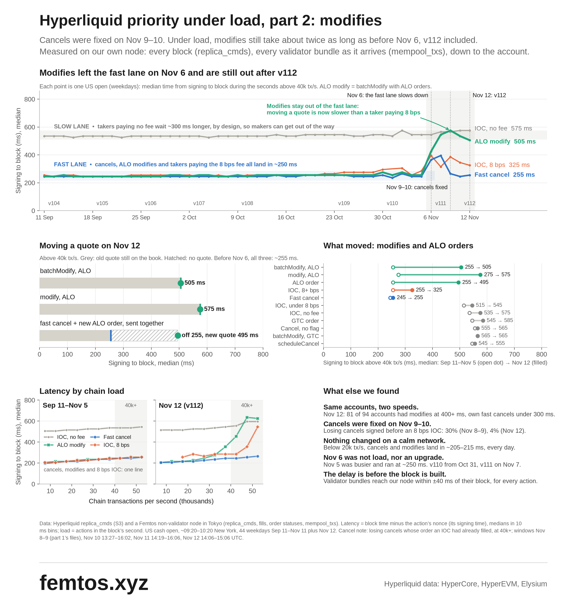

# Hyperliquid order priority under load, part 2: modifies

FrothyBeverage × Femtos ([femtos.xyz](https://femtos.xyz)) · Nov 12, 2026



## Summary

FrothyBeverage's first report showed cancels losing to orders signed after them during busy periods. The Hyperliquid team fixed that within days, and fast cancels are back to their usual speed. This follow-up looks at what else changed around the same time, and finds one thing worth sharing: modifies.

- **Cancels are fixed.** At 40k+ tx/s, losing fast cancels that were signed before the 8 bps IOC that filled them went from 30.6 % (Nov 8-9) to 1.4 % (Nov 11). Fast cancels land in \~245-255 ms again.
- **Modifies are still slower under load.** From Sep 11 to Nov 5, ALO modifies, ALO orders and cancels landed together at \~250 ms, even at 40k+ tx/s. Since Nov 6, at that load, a batchModify with ALO orders takes \~505 ms (Nov 12) and a single modify \~575 ms. New ALO orders moved with them.
- **Only under load.** Below \~30k tx/s nothing has changed: cancels, ALO orders and ALO modifies land in \~205-245 ms, as before.
- **For makers, for now:** under load, a fast cancel followed by a new ALO order takes the old quote off the book sooner than a modify, at the cost of a second transaction.

We share this as a measurement, with the code and data to check it: everything can be rebuilt from Hyperliquid's public S3 bucket, step by step in [Reproduce](#reproduce). We may well be missing context that the team has.

## Background

On Nov 10, FrothyBeverage published "Hyperliquid cancel priority under load": at 40k+ tx/s on Nov 8-9, 31 % of failed cancels had been signed before the 8 bps priority-fee IOC that filled the order. Femtos reproduced it on the same `replica_cmds` files and added data. Hyperliquid replied on Nov 11, and the cancel numbers recovered on Nov 10-11.

FrothyBeverage then asked whether modifies had been affected by the same change. Femtos pulled the data to answer that question, and this write-up is the result.

## Data and method

Everything comes from chain data, read passively. Nothing was tested on mainnet.

| Source | What it gives | Coverage |
| --- | --- | --- |
| `replica_cmds` (Hyperliquid's public S3) | every signed action, its nonce, the block it landed in | 45 weekday US opens, Sep 11 to Nov 12 |
| `node_fills_by_block` (Hyperliquid's public S3) | maker fills joined to their taker, priority fee paid | the cancel windows |
| `node_order_statuses_by_block` (Femtos node) | the account behind each order | Nov 12 |
| `mempool_txs` (Femtos node) | validator bundles, as received before any block | from Nov 11 |

- **Latency** = block time minus the action's nonce (the signer's clock, in ms). Medians on 10 ms bins.
- **Load** = signed actions in the block's second. Bands: below 20k, 30-40k and 40k+ tx/s.
- **Window** = about 10 minutes before the US cash open (09:30 New York) to about 50 minutes after.
- **Kinds** follow what the docs treat differently: fast vs non-fast cancels, ALO vs GTC vs IOC (by priority fee), and `modify` / `batchModify` by the time-in-force of the new order. A GTC modify is executable and sits in the slower lane by design, so only ALO modifies are compared with cancels.

## Two months of US opens

For 39 opens in a row, through six hardfork versions, fast cancels, ALO orders and ALO modifies landed together at \~250 ms, even at 40k+ tx/s. On Nov 6 all three slowed. Cancels came back on Nov 10-11; ALO orders and ALO modifies are still at about twice their earlier level under load, including after the Nov 12 upgrade (v112).

Nov 5 was the busiest open of the period (54 % of its seconds above 40k tx/s) and still ran at \~250 ms, so load on its own does not seem to explain the change.

## Modifies under load

Median signed→block, ms:

| Action | Nov 12, below 20k tx/s | Nov 12, 30-40k | Nov 12, 40k+ | 40k+, Sep 11 to Nov 5 (range of 36 opens) |
| --- | --- | --- | --- | --- |
| Fast cancel | 205 | 235 | 255 | 245-255 |
| ALO order | 205 | 295 | 495 | 245-255 |
| batchModify, ALO | 215 | 305 | 505 | 245-255 |
| modify, ALO | 245 | 345 | 575 | 255-335 |
| IOC, 8 bps priority fee | 255 | 285 | 325 | 245-285 |
| batchModify, GTC | 525 | 545 | 565 | 545-595 |

- The docs describe ALO orders as landing "with similar end-to-end latency as cancels". That holds on a calm network, and held under load until Nov 5.
- 98.5 % of batchModify actions carry ALO orders. A single `modify` has always been a little slower than `batchModify`.
- Batch size makes no difference: batchModify ALO lands in \~505 ms alone or with 2-10 modifies.
- GTC modifies did not change.

### Modify, or cancel and place?

| Moving a quote, 40k+ tx/s, Nov 12 (median, ms) | Old quote off the book | New quote on the book | Transactions |
| --- | --- | --- | --- |
| batchModify, ALO | 505 | 505 | 1 |
| modify, ALO | 575 | 575 | 1 |
| fast cancel and a new ALO order, sent together | 255 | 485-505 | 2 |

Under load, cancel + place takes the old quote off the book about 250 ms sooner. The new quote is an ALO order, slowed like the modifies, so it lands at about the same time as a modify would, and it costs two transactions instead of one, which counts against rate limits and block space. Below \~30k tx/s there is nothing to gain. If many makers switched, it would add load exactly when the chain is busiest, which is why we think the modify path is worth a look.

## Accounts

In the busiest 20 minutes of Nov 12 (14:30-14:50 UTC, seconds above 40k tx/s), 418 accounts sent at least 30 ALO orders and 30 fast cancels; together they carry 98 % of ALO orders. For 320 of them, the ALO median is 400 ms or more while their own fast cancels land in 300 ms or less. For batchModify ALO, 81 of the 94 accounts that also cancel show the same pattern.

Hyperliquid's Nov 11 update lists three account-level causes of delay (no `fast` flag, a non-Standard account abstraction, a recent non-trading action). Our cancel data agrees with it. Those causes apply to all of an account's actions, so they do not seem to account for the same account's cancels being fast while its ALO orders are slow. Other explanations remain possible from the outside, for example the per-address block-space limit during congestion, or time spent on the client between signing and sending.

Accounts come from the node's order statuses (user per order id and client order id); at 40k+ tx/s, 86 % of ALO orders and 81-100 % of fast cancels were matched.

## Where the time goes

A non-validator node writes `mempool_txs`, the validator bundles it receives before any block. On Nov 11 and 12, bundles reached the Femtos node within about ±40 ms of their block's time for every kind of action, and in block order. So the extra time under load is spent before a bundle is broadcast: on the client, at the API, or in the validators' queue. This data cannot tell those apart.

## Cancels

| Window (40k+ tx/s) | Losing fast cancels signed before the 8 bps IOC | Fast cancel, median signed→block | Cancels sent without `fast` |
| --- | --- | --- | --- |
| Nov 8-9 (the first report's windows) | 30.6 % (n = 1,528) | 395 ms | 1.80 % |
| Nov 10 | 12.9 % | 265 ms | 1.48 % |
| Nov 11 | 1.4 % | 245 ms | 1.27 % |

The share of cancels sent without the `fast` flag barely moved, so the improvement came from the network side. Thanks to the team for turning it around so quickly.

## Open questions

We would welcome the team's view on these:

1. Is there a known change around Nov 6 that would affect ALO orders and modifies under load?
2. Is the same treatment cancels received planned for ALO orders and ALO modifies?
3. Can the congestion limit on an address's share of block space slow its ALO orders while its cancels stay fast?

## Limits

- Latency uses the signer's clock. A median over hundreds of thousands of actions is robust to clock skew; a single action is not.
- Signed→block includes time on the client, the hop to the API and the validators' queue.
- One window a day, around the US open. Oct 30 and Nov 2-3 had few seconds above 40k tx/s; ranges above leave them out, read the 30-40k band there.
- `mempool_txs` exists only from Nov 11.

---

## Reproduce

There are two ways to check this work. **A** recomputes every number from the histograms we publish (two minutes, no account needed). **B** rebuilds those histograms yourself from Hyperliquid's public S3 bucket, data that we neither host nor control, and compares them with ours. B also works on any other day, so you can see whether the pattern still holds after we stopped looking.

### What you need

| For | Tools |
| --- | --- |
| A | Python 3.9+, `pip install matplotlib` (only for the figure) |
| B | the above, plus [Rust](https://rustup.rs) (to build `actlat`), [rclone](https://rclone.org/install/), `lz4`, and an AWS account |

Hyperliquid's bucket `hl-mainnet-node-data` is **requester pays**: anyone with an AWS account can read it, and that account pays for the transfer. Put your credentials where rclone and the AWS CLI find them (`AWS_ACCESS_KEY_ID` / `AWS_SECRET_ACCESS_KEY` in the environment, or `~/.aws/credentials`). An IAM user with read access to S3 is enough. One US open is 5 files of 1.2 to 2 GB (lz4). From an EC2 machine in Tokyo (ap-northeast-1) only request fees apply; from anywhere else, transfer costs about $0.09-0.11 per GB, roughly $1 per open.

### A. Recompute our numbers from the published histograms

```sh
git clone https://github.com/pejisdev/hyperliquid-priority-under-load && cd hyperliquid-priority-under-load
python3 scripts/make_tables.py      # data/opens/*.hist.csv.gz -> data/*.csv, ~2 min
python3 scripts/part2.py            # data/*.csv -> figure/hyperliquid-priority-part2.png
git diff --stat data/               # empty: the tables come out identical to the published ones
```

### B. Rebuild from Hyperliquid's S3

**1. Look at the bucket.**

```sh
aws s3 ls --request-payer requester s3://hl-mainnet-node-data/replica_cmds/
# or, with rclone and no config file:
rclone lsf ":s3,provider=AWS,env_auth=true,region=ap-northeast-1,requester_pays=true:hl-mainnet-node-data/replica_cmds/"
```

The layout is `replica_cmds/<period>/<YYYYMMDD>/<height>.lz4`. A period folder is named after the time Hyperliquid's writing node started (it changes at each network upgrade); `<height>` is the first block of the file, and each file holds 10,000 blocks (about 12 minutes at the US open). Each line of a decompressed file is one block: its time (`abci_block.time`) and every signed action in it, with the nonce its signer set (`signed_action_bundles`).

**2. Build `actlat` and try one file by hand.**

```sh
(cd actlat && cargo build --release)
aws s3 cp --request-payer requester \
  s3://hl-mainnet-node-data/replica_cmds/2026-11-07T08:18:35Z/20261111/1217440000.lz4 - \
  | lz4 -dc | actlat/target/release/actlat one > one.summary.csv
# or, with rclone:
rclone cat ":s3,provider=AWS,env_auth=true,region=ap-northeast-1,requester_pays=true:hl-mainnet-node-data/replica_cmds/2026-11-07T08:18:35Z/20261111/1217440000.lz4" \
  | lz4 -dc | actlat/target/release/actlat one > one.summary.csv
head one.summary.csv                # kind,load_band,n,p25_ms,p50_ms,p75_ms,p90_ms
```

That file is the one that contains 09:30 New York on Nov 11. `actlat` also writes `one.hist.csv`, `one.load.csv` and `one.out.csv` (formats in the table below).

**3. Rebuild a whole open and compare it with ours.**

```sh
python3 scripts/fetch_open.py 2026-11-11        # finds the files around 09:30 New York, writes out/opens/2026-11-11.*
python3 scripts/compare.py out data             # your histogram against the published one
```

What `compare.py` printed for Nov 11 when we ran it against the public bucket:

```
2026-11-11: 967,730 rows yours, 967,730 ours, 967,730 identical, 0 different  -> identical
  median at 40k+ tx/s, ms           yours         ours
  fast cancel                  245 n=2,060,102    245 n=2,060,102
  ALO order                    515 n=850,662      515 n=850,662
  batchModify ALO              535 n=161,383      535 n=161,383
  modify ALO                   595 n=1,055        595 n=1,055
  IOC 8 bps                    345 n=22,341       345 n=22,341
  IOC no fee                   575 n=98,635       575 n=98,635
```

`fetch_open.py` lists the period folders, reads the first block of candidate files to find the one that contains 09:30 New York, then streams that file, the one before it and three after it into `actlat`. It writes to `out/` and never touches `data/`. `compare.py` checks every row of both histograms (kind, minute, load bucket, 10 ms bin, count) and prints the 40k+ tx/s medians of the main action types side by side. When you read the same files, every row is identical. `--like data` makes `fetch_open.py` read exactly the files listed in `data/opens.csv`, and `--files N` changes how many files are read.

**4. Go further.**

```sh
python3 scripts/fetch_open.py 2026-11-16        # any day, including days after this write-up
python3 scripts/make_tables.py out              # out/latency_by_open.csv and the load curves for the opens you rebuilt
```

`out/latency_by_open.csv` gives the median per action type and load band for each open you rebuilt. If ALO orders and ALO modifies land with fast cancels again at 40k+ tx/s, the issue is gone.

### What is not rebuilt from public data

- **Per account:** `replica_cmds` has no user per action. `acctlat` takes it from `node_order_statuses_by_block`, which a node writes and the public bucket does not carry. With a non-validator node that writes order statuses: `acctlat T0 T1 OUT STATUS_FILE... -- REPLICA_FILE...`, then `python3 scripts/acctan.py OUT`.
- **Cancels:** maker fills joined to their taker from `node_fills_by_block` (in the same public bucket), with each cancel's signing time from `replica_cmds`. This repository does not include that join; the shares are written at the top of `part2.py`.
- **Validator bundles:** `mempool_txs` is written by a node and kept two hours; Femtos archives it since Nov 11.
- **Nov 12** was measured from the Femtos node's own `replica_cmds`. The same files are in the public bucket, under period `2026-11-12T10:43:59Z`.

### Files

| Path | What |
| --- | --- |
| `actlat/` | Rust: signed→block latency of every action in `replica_cmds`, by kind and chain load |
| `acctlat/` | Rust: the same per account (needs a node's order statuses) |
| `scripts/fetch_open.py` | rebuilds one open from Hyperliquid's S3 into `out/` |
| `scripts/compare.py` | compares a rebuilt open with the published one |
| `scripts/make_tables.py` | every table below from the raw histograms (`data/` by default, or the directory given) |
| `scripts/part2.py` | draws the figure from `data/` |
| `scripts/acctan.py` | per-account summary of `acctlat`'s output |
| `data/opens.csv` | one row per open: date, S3 period folder, files read, hardfork |
| `data/opens/<date>.hist.csv.gz` | raw histogram of one open: `kind,unix_minute,load_bucket,latency_ms,count` |
| `data/opens/<date>.load.csv` | actions and blocks per second: `unix_second,actions,blocks` |
| `data/latency_by_open.csv` | median per open, load band and family: `date,hardfork,load_band,family,n,median_ms` |
| `data/latency_40k_by_period.csv` | median at 40k+ tx/s per period: `period,family,n,median_ms` |
| `data/load_curve_2500.csv`, `data/load_curve_5000.csv` | median per period, family and load step: `period,family,load_from,n,median_ms` |

In the histograms, `unix_minute` is unix time / 60, `load_bucket` is the number of actions in the block's second floored to 2,500, and `latency_ms` is the lower edge of a 10 ms bin (-50 to 5,000 ms). `actlat` puts each action in a kind: `cancel` / `cancelByCloid` with or without `fast`; orders by time-in-force, IOC also by priority fee (none, under 8 bps, 8 bps and more); `modify` / `batchModify` by the time-in-force of the new order(s) and by batch size. Periods: `sep11-nov05`, `nov06`, `nov11`, `nov12`. Families: `cancel_fast`, `cancel_nofast`, `alo_order` (no priority fee), `alo_order_fee`, `alo_order_any` (both), `batchmodify_alo`, `modify_alo`, `batchmodify_gtc`, `modify_gtc`, `ioc_8bps`, `ioc_under_8bps`, `ioc_nofee`, `gtc_order`, `frontend_market`, `schedule_cancel`.

---

Decentralization and open nodes let anyone check this data independently. We see that as a strength, not a weakness, next to other perp DEXs, and we thank Hyperliquid for making it all available.

Research with FrothyBeverage. Data and code by [femtos.xyz](https://femtos.xyz), Hyperliquid data: HyperCore, HyperEVM, Elysium.
