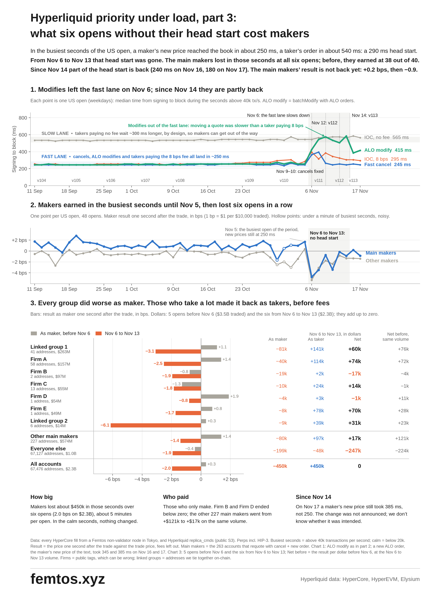

# Hyperliquid order priority under load, part 3: what six opens without their head start cost makers

Femtos ([femtos.xyz](https://femtos.xyz)) · Nov 17, 2026 · follows [part 2](README.md) and FrothyBeverage's report on cancels



The same paper on one longer page, with every note: [figure/hyperliquid-priority-part3-full.png](figure/hyperliquid-priority-part3-full.png).

## Summary

Market makers are the accounts whose prices you trade against. When the market moves, they have to update those prices fast.

- **The head start.** In the busiest seconds of the US open (above 40k transactions per second), a maker's new price reached the book in about 250 ms and a taker's order in about 540 ms: a 290 ms head start for the maker.
- **Six opens without it.** From Nov 6 to Nov 13 the maker's new price took about 520 ms. The taker decided last in 86 % of matched trades, up from 29 %.
- **What it cost.** In those seconds the main makers lost money at each of the six opens. Before, they earned at 38 opens out of 40. All makers together lost about $450k: 2.0 bps on $2.3B traded, in about 5 minutes per open.
- **Only under load.** In the calm seconds of the same opens, nothing changed.
- **Who paid.** Every group did worse as maker. Those who also take a lot made it back as takers, before fees. Those who only make did not.
- **Since Nov 14.** Part of the head start is back: 240 ms on Nov 16, 180 ms on Nov 17. The main makers' result is not back yet: +0.2 bps, then −0.9.

The change was not announced, and we do not know whether it was intended. We share this as a measurement, with the code and the tables to check it. Other readings are welcome.

## What changed: the time an order takes

Median time from signing an order to the block that holds it, in the seconds above 40k tx/s of each US open (ms):

| Open | Network | Maker's new price (new ALO order) | ALO modify (batchModify) | Fast cancel | Taker order, no fee | Taker order, 8 bps fee or more | Head start (taker, no fee − new price) |
| --- | --- | --- | --- | --- | --- | --- | --- |
| Nov 4 | v110 | 255 | 255 | 245 | 545 | 255 | 290 |
| Nov 5 | v110 | 255 | 255 | 245 | 545 | 285 | 290 |
| Nov 6 | v110 | 405 | 425 | 365 | 545 | 395 | 140 |
| Nov 9 | v111 | 525 | 545 | 395 | 565 | 315 | 40 |
| Nov 10 | v111 | 535 | 575 | 265 | 565 | 385 | 30 |
| Nov 11 | v111 | 515 | 535 | 245 | 575 | 345 | 60 |
| Nov 12 | v112 | 495 | 505 | 255 | 575 | 325 | 80 |
| Nov 13 | v112 | 545 | 585 | 245 | 565 | 305 | 20 |
| Nov 16 | v113 | 345 | 385 | 255 | 585 | 305 | 240 |
| Nov 17 | v113 | 385 | 415 | 245 | 565 | 295 | 180 |

- **Before Nov 6** the head start was between 280 and 310 ms at each of the 40 opens from Sep 11 to Nov 5.
- **Nov 5** was the busiest open of the period, and new prices still took 255 ms. **Nov 6** was a lighter day.
- **Cancels** slowed too on Nov 6 and were back to their usual speed from Nov 10 (part 2). New prices were not.
- All 48 opens and every order family: `data/part3/order_delays_by_open.csv`. Chart 1 of the figure draws the ALO modify, as in part 2.

## What it cost makers

The result of a maker trade is the price one second after the trade against the trade price, in bps (1 bp = $1 per $10,000 traded). Positive is good for the maker. Fees are left out.

Seconds above 40k tx/s, 40 opens from Sep 11 to Nov 5 against the six opens from Nov 6 to Nov 13:

| Makers | Result at 1 s, bps | Result at 5 s, bps | Volume, Nov 6 to Nov 13 |
| --- | --- | --- | --- |
| All | +0.23 → −1.96 | −0.08 → −3.36 | $2.30B |
| Main makers (263 accounts that requote with cancel + new order) | +1.13 → −1.80 | +1.11 → −3.17 | $854M |
| Modifiers (51 accounts) | +1.88 → −1.75 | +1.59 → −3.86 | $194M |
| Other | −0.47 → −2.10 | −0.94 → −3.42 | $1.25B |
| All, calm seconds (below 20k tx/s) | +0.31 → +0.43 | +0.14 → +0.43 | $1.16B |

Open by open:

| Open | Seconds above 40k | Maker volume | All makers, bps | All makers, $ | Main makers, bps | Average 1 s move, bps |
| --- | --- | --- | --- | --- | --- | --- |
| Nov 5 | 1,347 | $1,551M | +1.10 | +$171k | +1.70 | 4.6 |
| Nov 6 | 167 | $326M | −5.29 | −$172k | −4.76 | 8.3 |
| Nov 9 | 218 | $316M | −3.29 | −$104k | −3.48 | 6.2 |
| Nov 10 | 474 | $557M | −1.33 | −$74k | −0.74 | 4.3 |
| Nov 11 | 168 | $117M | −2.60 | −$30k | −3.42 | 5.8 |
| Nov 12 | 425 | $598M | −0.44 | −$26k | −0.17 | 4.8 |
| Nov 13 | 508 | $382M | −1.12 | −$43k | −0.90 | 4.5 |
| Nov 16 | 259 | $323M | −0.57 | −$18k | +0.19 | 4.5 |
| Nov 17 | 148 | $119M | −1.10 | −$13k | −0.88 | 4.0 |

- **Six opens, Nov 6 to Nov 13:** −$450k for all makers, about $75k per open. The worst open before Nov 6 was −$73k.
- **The main makers** were the steadiest earners: positive at 38 of the 40 opens before Nov 6 (the two others had 133 and 43 seconds above 40k tx/s), negative at all six.
- **Seconds** are those with at least one maker trade: on Nov 17, 148 of the 152 seconds above 40k tx/s.
- Chart 2 of the figure draws the 48 opens. Table: `data/part3/maker_markouts_by_open.csv` and `maker_markouts_after_nov13.csv`.

## Who decided last

`replica_cmds` carry every signed order with its signing time. For the trades where both orders carry a client order id, we tied the trade to the maker's price and to the taker's order, and compared the two signing times. Ten opens: five before Nov 6 (Oct 15, 21, 29, Nov 4, 5) and five after (Nov 6, 9, 10, 12, 13). These matched trades are 9 to 29 % of maker volume in the seconds above 40k tx/s.

| The taker signed | Before Nov 6: share of matched volume | Maker result, bps | Nov 6 to Nov 13: share | Maker result, bps |
| --- | --- | --- | --- | --- |
| Before the maker's price | 71 % | +2.19 | 14 % | +1.29 |
| 0 to 100 ms after | 7 % | −1.17 | 7 % | −2.83 |
| 100 to 200 ms after | 5 % | −2.28 | 10 % | −3.44 |
| 200 to 300 ms after | 4 % | −2.24 | 11 % | −3.32 |
| 300 to 400 ms after | 3 % | −2.37 | 11 % | −4.05 |
| 400 to 600 ms after | 6 % | −2.90 | 17 % | −4.47 |
| 600 ms or more after | 4 % | −3.71 | 29 % | −4.44 |

- **The same rule in both periods.** A maker hit by a taker who decided first earns. Hit by a taker who decided later, on a newer price, it loses.
- **What changed is the mix.** The taker decided last in 29 % of matched volume before Nov 6, and in 86 % from Nov 6 to Nov 13.
- **Since Nov 14:** 62 % at the Nov 16 open, 78 % at the Nov 17 open.
- Takers did nothing wrong: they traded against prices that were in the book.

## Who paid, who gained

Every trade in the seconds above 40k tx/s of 5 opens before Nov 6 (Oct 15, 21, 29, Nov 4, 5: $3.5B traded) and of the six opens from Nov 6 to Nov 13 ($2.3B), by account. Each trade counts once as a maker result and once, with the opposite sign, as a taker result, so the dollars add up to zero.

| Group | Addresses | Maker volume, Nov 6 to Nov 13 | As maker, bps: before → Nov 6 to Nov 13 | As maker | As taker | Net | Net before, same volume |
| --- | --- | --- | --- | --- | --- | --- | --- |
| Linked group 1 | 41 | $263M | +1.1 → −3.1 | −$81k | +$141k | +$60k | +$76k |
| Firm A | 58 | $157M | +1.4 → −2.5 | −$40k | +$114k | +$74k | +$72k |
| Firm B | 2 | $97M | −0.8 → −1.9 | −$19k | +$2k | −$17k | −$4k |
| Firm C | 13 | $55M | −1.3 → −1.8 | −$10k | +$24k | +$14k | −$1k |
| Firm D | 1 | $54M | +1.9 → −0.8 | −$4k | +$3k | −$1k | +$11k |
| Firm E | 1 | $49M | +0.8 → −1.7 | −$8k | +$78k | +$70k | +$28k |
| Linked group 2 | 6 | $14M | +0.3 → −6.1 | −$9k | +$39k | +$31k | +$23k |
| Other main makers | 227 | $574M | +1.4 → −1.4 | −$80k | +$97k | +$17k | +$121k |
| Everyone else | 67,127 | $1.0B | −0.4 → −1.9 | −$199k | −$48k | −$247k | −$224k |
| **All accounts** | 67,476 | $2.3B | +0.3 → −2.0 | **−$450k** | **+$450k** | **0** | |

- **Every group did worse as maker.**
- **Those who take a lot made it back as takers,** before fees: Linked group 1, Firm A, Firm E.
- **Those who take least were worse off.** Firm B and Firm D, who mostly make, ended below zero. The other 227 main makers went from +$121k to +$17k on the same volume.
- **Everyone else** lost about as much per dollar traded as before: 1.0 bps of the volume they traded before Nov 6, 1.1 from Nov 6 to Nov 13.
- **Takers who pay the priority fee,** an optional fee to arrive sooner, made +6.1 bps per trade from Nov 6 to Nov 13 ($926M) against +3.2 before ($844M), before their fees.

"Net before, same volume" is a group's result per dollar traded before Nov 6, applied to the volume it traded from Nov 6 to Nov 13, so that column does not add up. Firms are addresses with a public tag, which can be wrong; linked groups are addresses we tie together on-chain. The paper is about a rule of the exchange, so names are left out, and so are the addresses behind each row. Table: `data/part3/result_by_group.csv`.

## Since Nov 14

- **Nov 14** was a Saturday with no US open. In its evening sell-off (20:46 to 22:32 UTC, 336 seconds above 40k tx/s) a maker's new price took 335 ms and a taker order 595 ms. The main makers made +2.6 bps on $258M, and the maker decided last in 69 % of matched volume. The head start was already back earlier that day, in the busy stretch of 02:16 to 03:40 UTC, before the move to network version 113 at 08:35 UTC.
- **Nov 16 and Nov 17 opens** (259 and 152 seconds above 40k tx/s): a maker's new price took 345 and 385 ms, a taker order 585 and 565 ms. Main makers: +0.2 bps on $129M, then −0.9 bps on $42M. All makers: −0.6 bps (−$18k), then −1.1 bps (−$13k).
- **The delay now grows with load.** On those two opens a maker's new price took 315 to 335 ms at 40–42.5k tx/s (245 before Nov 6, 415 on Nov 12) and 435 to 465 ms at 47.5–52.5k (255 before Nov 6, 605 to 665 on Nov 12).
- **And so does the result.** Over the two opens the main makers made +0.6 bps at 40–45k tx/s ($107M) and lost 1.2 bps above 45k ($64M).

## Why it matters

Hyperliquid's docs say its execution logic is "designed to protect makers against toxic flow, so that end users see tight spreads and deep liquidity even during volatility", mainly because "cancels and ALO orders sent at time `t` will almost always execute before IOC and GTC orders sent at time `t`" ([Optimizing latency](https://hyperliquid.gitbook.io/hyperliquid-docs/for-developers/api/optimizing-latency)). The 290 ms head start is that protection. For six opens it was gone, unannounced: the cost fell on those who only make, the gain went to those who take.

## What we don't know, and limits

- **Whether it was intended,** and what changed on Nov 14.
- **Whether the rest will come back.** Nov 16 and Nov 17 are two small opens.
- **Two opens weigh most.** Nov 6 and Nov 9 make 61 % of the $450k and had the largest price moves of the six (8.3 and 6.2 bps on average in one second, 3.8 before Nov 6). A busier market alone does not explain the loss: Nov 5, the busiest open of the period, had the old delays and makers earned; and the calm seconds of the six opens did not change.
- **Fees are left out:** exchange fees, rebates and priority fees. We do not know whether the takers who pay a priority fee gained after their fees.
- **Matched trades are a sample:** 10 opens and 9 to 29 % of maker volume, the trades whose two orders carry a client order id. The result tables cover every trade.
- **Signing times are the traders' own clocks.** Medians over many orders hold up to clock differences; a single trade does not.
- **The later price is the last trade, not the mid,** the same way over the whole period.
- **Maker groups come from one day** of actions (Nov 12). **Only US opens** (and one Saturday evening). Perps only, HIP-3 included.

## Data and method

Everything is chain data read passively, as in parts 1 and 2. Nothing was tested on mainnet.

- **Opens:** 48 weekday US opens, Sep 11 to Nov 17: 40 before Nov 6, six from Nov 6 to Nov 13, then Nov 16 and Nov 17. Each is five 10,000-block `replica_cmds` files starting about 10 minutes before 09:30 New York (`data/opens.csv`, `data/part3/opens_since_nov13.csv`).
- **Load:** signed actions in the block's second, from `replica_cmds`. Busiest seconds = above 40k tx/s; calm = below 20k.
- **Order times:** block time minus the order's nonce (the signer's clock), medians on 10 ms bins, per order family, with `actlat` of part 2.
- **Trades:** every HyperCore maker fill on perps from a Femtos non-validator node in Tokyo. The same fills are in Hyperliquid's public bucket as `node_fills_by_block`.
- **Result (markout):** for a maker fill at price p, the last trade in the same coin 1 s later (and 5 s later): (later − p) / p for a maker buy, the opposite for a sell, in bps, weighted by notional. No cap on a trade's result in the totals.
- **Maker groups,** from each account's actions at the Nov 12 open. Main makers = 263 accounts with at least 2,000 ALO actions, under 5 % of modifies, and cancels for at least 30 % of their placements: they requote with cancel + new order. Modifiers = 51 accounts with at least half of their ALO actions as modifies. Everyone else is "other".
- **Matched trades:** `flightlat` reads `replica_cmds` and keeps every order whose client order id is on a fill of the open, with its signing time and block. A trade is matched when both the maker's ALO order and the taker's order are found, and the maker's order landed less than 1 s before the trade.
- **Priority fee:** an optional fee a taker order can carry to arrive sooner. "Takers who pay the priority fee" = trades of orders sent with one, whatever its size.

## Reproduce

**A. The figures from the published tables** (Python 3.9+, `pip install matplotlib`, Liberation Sans installed):

```sh
python3 scripts/part3/part3_figure.py data/part3 figure/hyperliquid-priority-part3.png
python3 scripts/part3/part3_figure_full.py data/part3 figure/hyperliquid-priority-part3-full.png
```

Both scripts check the figures written in their texts against the tables before drawing.

**B. From the chain.** You need HyperCore fills in a ClickHouse table (`hypercore_fills`, schema at the top of `scripts/part3/run_open.sh`; any node's `node_fills_by_block`, or the same files in Hyperliquid's bucket, will fill it), the S3 access of part 2, and your own file of maker groups (`groups.tsv`, rules above).

```sh
(cd flightlat && cargo build --release)
scripts/part3/run_open.sh 2026-11-17 2026-11-14T08:35:29Z 1224680000        # date, S3 period, first block
python3 scripts/part3/open_markouts.py 2026-11-17 o.2026-11-17.fills.tsv o.2026-11-17.load.tsv groups.tsv   # rows of maker_markouts_by_open.csv
python3 scripts/part3/matched_trades.py nov17 2026-11-17                    # who decided last, result by gap, takers by fee lane
python3 scripts/part3/markout_by_load.py groups.tsv nov16-17=2026-11-16,2026-11-17
python3 scripts/part3/order_delays.py 2026-11-17 113 out/opens/2026-11-17.hist.csv   # actlat's histogram, written by scripts/fetch_open.py (part 2, Reproduce B)
CAP=1e9 SHOW='name 1|name 2' python3 scripts/part3/by_group.py . labels.tsv groups.tsv 2026-11-05 2026-11-06   # the table by group, with your own labels
```

| Path | What |
| --- | --- |
| `figure/hyperliquid-priority-part3.png`, `-full.png` | the paper on one page, short and full |
| `data/part3/maker_markouts_by_open.csv`, `maker_markouts_after_nov13.csv` | per open, load band and maker group: `seconds, fills, notional_usd, markout_1s_bps, markout_5s_bps, abs_move_1s_bps` |
| `data/part3/order_delays_by_open.csv` | per open and order family, seconds above 40k tx/s: `n, median_ms` |
| `data/part3/head_start_buckets.csv` | matched trades: share of volume and maker result by how much later the taker signed, before and since Nov 6 |
| `data/part3/result_by_group.csv` | the table by group |
| `data/part3/opens_since_nov13.csv` | S3 period and first block of the opens after part 2 |
| `flightlat/` | Rust: from `replica_cmds`, the signing time and block of every order whose client order id is wanted; load per second |
| `scripts/part3/run_open.sh` | one open: maker fills with their result, takers, priority fees, then `flightlat` over the S3 files |
| `scripts/part3/open_markouts.py`, `markout_by_load.py` | maker result per open and load band; per load bin |
| `scripts/part3/matched_trades.py` | matched trades: who decided last, result by gap, takers by fee lane |
| `scripts/part3/order_delays.py` | order times per family for one open |
| `scripts/part3/by_group.py` | result as maker and as taker by label |
| `scripts/part3/part3_figure.py`, `part3_figure_full.py` | the two figures |

---

Hyperliquid publishes every signed action, which is what makes a study like this possible from the outside. Thanks to the team for that, and for the quick cancel fix.

Data and code by [femtos.xyz](https://femtos.xyz).
